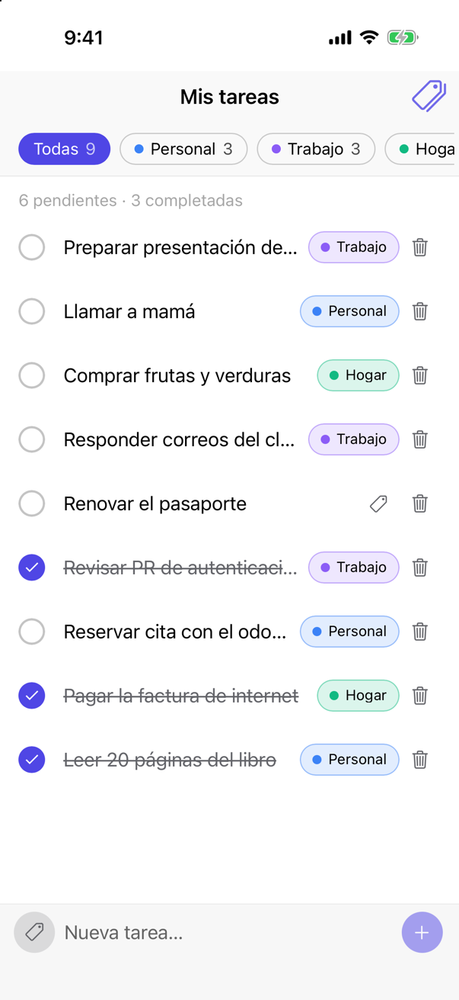
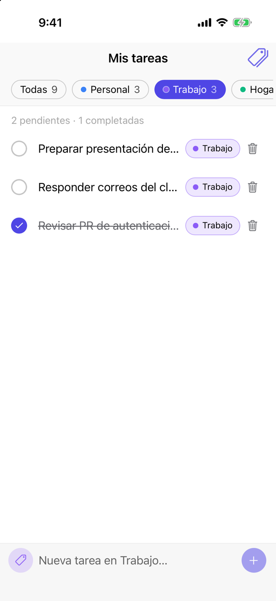
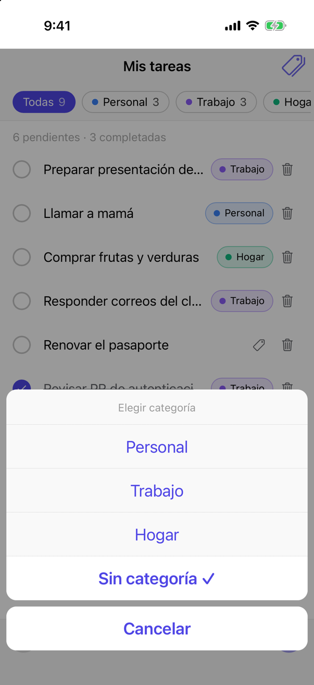
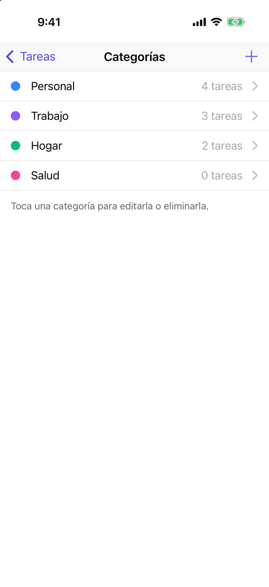
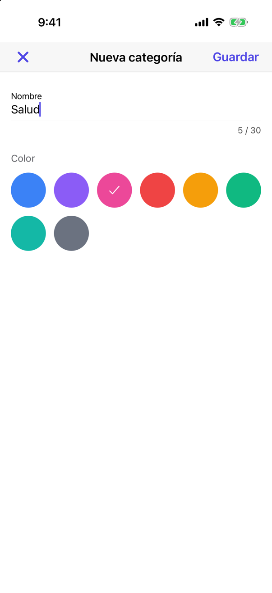
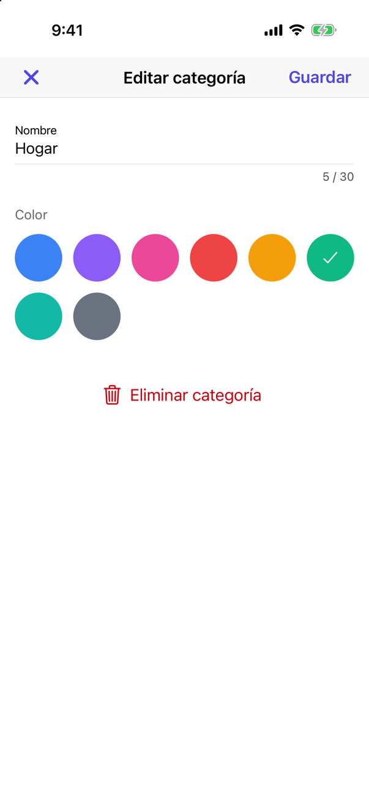
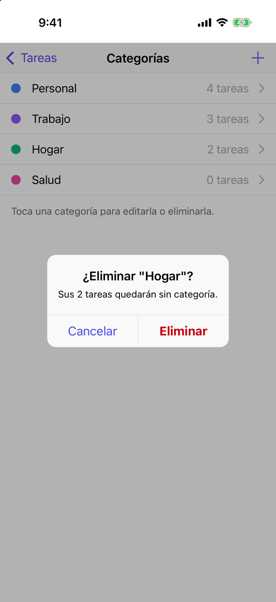
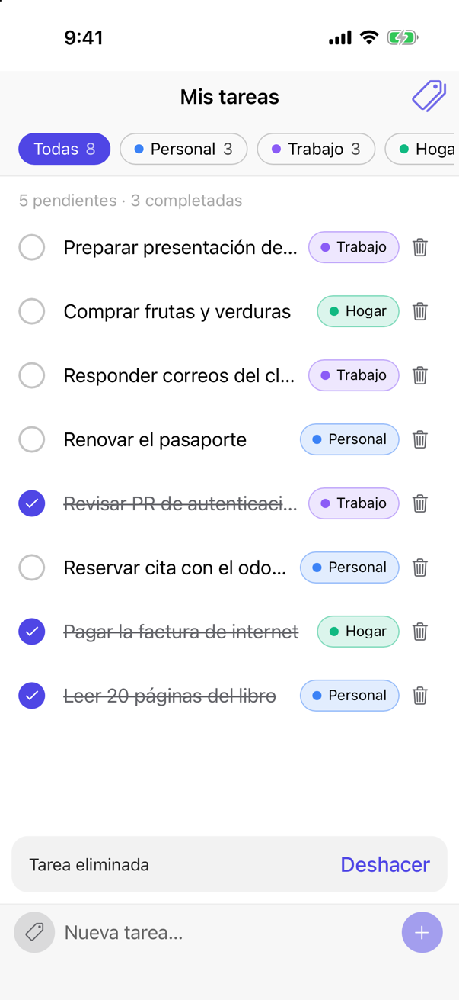
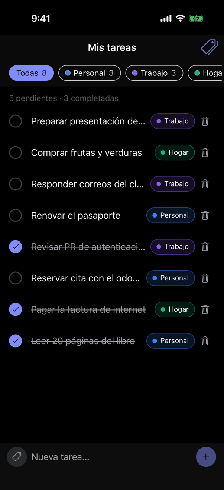
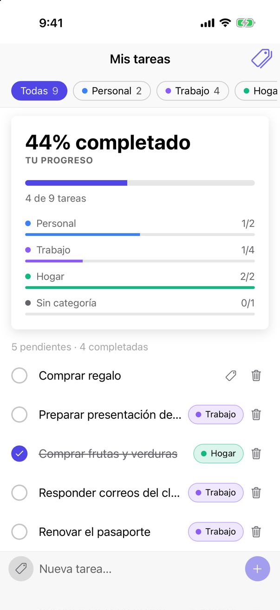

# Tareas · Ionic To-Do con categorías

[](https://github.com/LuisMiguelRobles/ionic-todo-categories/actions/workflows/ci.yml)

Aplicación híbrida de lista de tareas construida con **Ionic 9 + Angular 22** y empaquetada con **Cordova** para Android e iOS.

## Entrega

|                                |                                                                                                                                                                                                                                                                                                                                                                                                                                                                       |
| ------------------------------ | --------------------------------------------------------------------------------------------------------------------------------------------------------------------------------------------------------------------------------------------------------------------------------------------------------------------------------------------------------------------------------------------------------------------------------------------------------------------- |
| **Descargas**                  | [APK](https://github.com/LuisMiguelRobles/ionic-todo-categories/releases/latest/download/Tareas.apk) · [IPA sin firmar](https://github.com/LuisMiguelRobles/ionic-todo-categories/releases/latest/download/Tareas-unsigned.ipa) · [app para el simulador de iOS](https://github.com/LuisMiguelRobles/ionic-todo-categories/releases/latest/download/Tareas-simulator.zip) ([todas las versiones](https://github.com/LuisMiguelRobles/ionic-todo-categories/releases)) |
| **Capturas y video**           | [Capturas y video](#capturas-y-video)                                                                                                                                                                                                                                                                                                                                                                                                                                 |
| **Respuestas a las preguntas** | [Desafíos, optimización y calidad](#respuestas-a-las-preguntas)                                                                                                                                                                                                                                                                                                                                                                                                       |
| **Cambios realizados**         | [Resumen por fase](#cambios-realizados)                                                                                                                                                                                                                                                                                                                                                                                                                               |
| **Cómo ejecutar y probar**     | [Navegador](#ejecutar-en-el-navegador) · [Android e iOS](#android-e-ios) · [Cómo probar la app](#cómo-probar-la-app)                                                                                                                                                                                                                                                                                                                                                  |

## Capturas y video

Capturas del build de la release en el simulador de iOS (iPhone 17 Pro):

|                                                           Lista con categorías                                                           |                                                         Filtro por categoría                                                         |                                                       Asignar categoría                                                        |
| :--------------------------------------------------------------------------------------------------------------------------------------: | :----------------------------------------------------------------------------------------------------------------------------------: | :----------------------------------------------------------------------------------------------------------------------------: |
|                          |  |  |
|                                                              **Categorías**                                                              |                                                         **Nueva categoría**                                                          |                                                      **Editar categoría**                                                      |
|                       |         |         |
|                                                          **Eliminar categoría**                                                          |                                                     **Eliminar con "Deshacer"**                                                      |                                                        **Modo oscuro**                                                         |
|  |                    |                                      |

**Feature flag `enable_task_stats`** (Firebase Remote Config):

|                                       Flag desactivado                                        |                                                   Flag activado                                                    |
| :-------------------------------------------------------------------------------------------: | :----------------------------------------------------------------------------------------------------------------: |
|  |  |

**Videos:**

- [Recorrido por las funcionalidades](docs/media/demo.mp4?raw=true) (iOS, 1 min): filtrar, completar, cambiar de categoría, eliminar y deshacer, categorías y agregar una tarea.
- [Feature flag en acción](docs/media/feature-flag.mp4?raw=true) (iOS): con la tarjeta de progreso visible se publica `enable_task_stats = false` en Firebase, se desliza la lista hacia abajo y la tarjeta desaparece sin reinstalar la app (34 s).

## Funcionalidades

**Tareas**

- Agregar (con Enter o con el botón), marcar como completada y eliminar (botón o deslizar) con **"Deshacer"**.
- Contador de pendientes y completadas según el filtro activo.
- Lista virtual: fluida con miles de tareas (ver [Rendimiento](#rendimiento)).

**Categorías**

- Crear, editar (nombre y color de una paleta accesible) y eliminar categorías desde la pantalla **Categorías** (ícono de etiquetas en el encabezado).
- Validación en línea: nombre obligatorio, máximo 30 caracteres y sin duplicados (sin distinguir mayúsculas).
- Asignar o cambiar la categoría de una tarea tocando su chip, que abre un action sheet nativo.
- **Filtrar** con los chips del encabezado: _Todas_, cada categoría o _Sin categoría_, cada uno con su contador.
- Al filtrar por una categoría, las tareas nuevas se crean en esa categoría. También se puede cambiar con el botón de etiqueta junto al campo de texto.
- Al eliminar una categoría se pide confirmación indicando cuántas tareas afecta. **Las tareas no se borran**: quedan sin categoría.

**Feature flag (Firebase Remote Config)**

- Con el flag `enable_task_stats` activo aparece la tarjeta **"Tu progreso"**: porcentaje completado y avance por categoría. Ver [Firebase Remote Config](#firebase-remote-config).

## Stack

| Capa          | Tecnología                                                                           |
| ------------- | ------------------------------------------------------------------------------------ |
| UI            | Ionic 9 (componentes standalone), Angular 22 con signals y `OnPush`                  |
| Estado        | Stores basados en `signal` / `computed` (sin librerías externas)                     |
| Listas        | `@angular/cdk/scrolling` (lista virtual)                                             |
| Persistencia  | `@ionic/storage` (IndexedDB) con escrituras agrupadas (debounce)                     |
| Feature flags | Firebase Remote Config (`@firebase/app` + `@firebase/remote-config`, carga diferida) |
| Híbrido       | Cordova 13 · cordova-android 15 · cordova-ios 8 · `@ionic/cordova-builders`          |
| Calidad       | ESLint (angular-eslint), Prettier, Vitest, Playwright                                |

## Requisitos

- **Node 24 LTS** (hay un `.nvmrc`: ejecuta `nvm use`). Angular 22 no soporta Node 23.
- Ionic CLI y Cordova vienen como dependencias de desarrollo, así que **no hace falta instalarlos globalmente**: los scripts de `npm` usan las versiones del proyecto.
- Para compilar las apps nativas, ver [Android e iOS](#android-e-ios).

## Ejecutar en el navegador

```bash
nvm use
npm install
npm start
```

Abre <http://localhost:4200>. Para verlo como teléfono, usa el modo dispositivo de las DevTools.

## Scripts

| Comando                               | Qué hace                                                                                 |
| ------------------------------------- | ---------------------------------------------------------------------------------------- |
| `npm start`                           | Servidor de desarrollo                                                                   |
| `npm run build`                       | Build de producción en `www/`                                                            |
| `npm run test:unit`                   | Pruebas unitarias (Vitest)                                                               |
| `npm run test:e2e`                    | Pruebas end-to-end (Playwright; requiere `npx playwright install --only-shell chromium`) |
| `npm run lint`                        | ESLint + typecheck de e2e + Prettier                                                     |
| `npm run android:*` / `npm run ios:*` | Compilar y ejecutar en nativo (ver [Android e iOS](#android-e-ios))                      |

## Android e iOS

La app se empaqueta con **Cordova 13** (cordova-android 15, cordova-ios 8). Las plataformas (`platforms/`) no se versionan: `package.json` las declara y Cordova las regenera.

### Preparar el entorno

**Android**

1. Instala [Android Studio](https://developer.android.com/studio). En _SDK Manager_ instala **Android SDK Platform 36**, **Build-Tools 36** y **Command-line Tools**. En _Device Manager_, crea un emulador.
2. Instala **JDK 17** y **Gradle**. El JDK que trae Android Studio puede ser más nuevo (p. ej. 25) y Gradle 8.14, que usa Cordova, no lo soporta.

   ```bash
   brew install openjdk@17 gradle
   ```

3. Agrega a tu `~/.zshrc`:

   ```bash
   export JAVA_HOME=/opt/homebrew/opt/openjdk@17/libexec/openjdk.jdk/Contents/Home
   export ANDROID_HOME=$HOME/Library/Android/sdk
   export PATH=$JAVA_HOME/bin:$ANDROID_HOME/cmdline-tools/latest/bin:$ANDROID_HOME/platform-tools:$ANDROID_HOME/emulator:$PATH
   ```

**iOS** (solo macOS)

1. Instala **Xcode** desde la App Store y ábrelo una vez para que instale sus componentes y el simulador de iOS.
2. Selecciona Xcode como herramienta activa y acepta la licencia:

   ```bash
   sudo xcode-select -s /Applications/Xcode.app/Contents/Developer
   sudo xcodebuild -license accept
   ```

Comprueba el entorno con `npm run cordova:requirements`.

### Ejecutar en un emulador o dispositivo

```bash
npm install
npx cordova prepare          # descarga las plataformas declaradas en package.json
```

| Objetivo                                          | Comando                                                                                                                   |
| ------------------------------------------------- | ------------------------------------------------------------------------------------------------------------------------- |
| Emulador de Android                               | `npm run android:run -- --emulator`                                                                                       |
| Dispositivo Android (con depuración USB activada) | `npm run android:run -- --device`                                                                                         |
| Simulador de iOS                                  | `npm run ios:run -- --emulator --target "iPhone-17"`                                                                      |
| Ver simuladores/emuladores disponibles            | `npx cordova run ios --list` / `npx cordova run android --list`                                                           |
| iPhone físico                                     | `npm run ios:build`, abre `platforms/ios/App.xcworkspace` en Xcode, elige tu _Team_ en _Signing & Capabilities_ y pulsa ▶ |

Si no hay un emulador de Android encendido, `android:run -- --emulator` arranca el primero que encuentre. Los scripts usan `--no-native-run` para que Cordova instale y abra la app: native-run, la herramienta por defecto de Ionic, no arranca emuladores y busca la app de iOS en una carpeta que cordova-ios 8 ya no usa.

Con un Apple ID gratuito, Xcode puede instalar la app en tu propio iPhone; la firma dura 7 días. Para distribuirla hace falta una cuenta de Apple Developer de pago.

### Compilar

| Comando                           | Resultado                                                                                         |
| --------------------------------- | ------------------------------------------------------------------------------------------------- |
| `npm run android:build`           | APK de debug en `platforms/android/app/build/outputs/apk/debug/app-debug.apk`                     |
| `npm run android:release`         | APK de release firmado; requiere `build.json` (ver [Firma de Android](#firma-de-android))         |
| `npm run ios:ipa`                 | IPA sin firmar a partir de la plataforma iOS ya preparada (ver [IPA sin firmar](#ipa-sin-firmar)) |
| `npm run ios:build -- --emulator` | `platforms/ios/build/Debug-iphonesimulator/Tareas.app`                                            |

### Detalles de la integración

- **Builder de Angular:** los targets `ionic-cordova-build` e `ionic-cordova-serve` de `angular.json` usan `@ionic/cordova-builders` para inyectar `cordova.js` en el build.
- **iOS usa el esquema `app://localhost`**, porque `file://` bloquea los módulos ES que genera Angular. Android sirve los archivos desde `https://localhost` (WebViewAssetLoader).
- **Versión mínima: iOS 17** (`deployment-target` en `config.xml`), porque el WebView usa el motor de Safari del sistema y Angular 22 requiere Safari 17. En Android, el WebView se actualiza desde Play Store.
- **Íconos y splash:** `resources/icon.svg` es la fuente del ícono. Android usa ícono adaptativo (primer plano y fondo) y el splash nativo de Android 12+. En iOS, todos los tamaños se generan sin canal alfa, como exige la App Store.
- **Teclado en iOS:** `cordova-plugin-ionic-keyboard` reduce el WebView cuando se abre el teclado (`KeyboardResize`), así el campo de nueva tarea queda justo encima del teclado en lugar de desplazar toda la página. Se usa una copia con una corrección para cordova-iOS 8 (ver [`cordova-plugins/`](cordova-plugins/README.md)).
- **Splash sin espera fija:** `AutoHideSplashScreen=false` y la app lo oculta al pintar la primera pantalla (`core/platform/splash-screen.ts`). Así se evitan los 3 s de espera por defecto de Cordova.

### Problemas comunes

| Síntoma                                                                                          | Solución                                                                                                                                                                                                  |
| ------------------------------------------------------------------------------------------------ | --------------------------------------------------------------------------------------------------------------------------------------------------------------------------------------------------------- |
| `Could not find an installed version of Gradle`                                                  | `brew install gradle`                                                                                                                                                                                     |
| `Unsupported class file major version` / Gradle no arranca                                       | `JAVA_HOME` apunta a un JDK distinto de 17                                                                                                                                                                |
| `xcodebuild requires Xcode, but active developer directory ... is a command line tools instance` | `sudo xcode-select -s /Applications/Xcode.app/Contents/Developer`                                                                                                                                         |
| Pantalla en blanco en iOS                                                                        | Comprueba que `config.xml` mantenga `scheme=app` y `hostname=localhost`                                                                                                                                   |
| El splash no desaparece y los plugins no responden                                               | Se empaquetó el `cordova.js` de otra plataforma. Compila siempre con los scripts (`npm run ios:build`, `npm run android:build`), que regeneran `www` por plataforma; no uses `cordova build` directamente |

## Descargas

Cada versión se publica en [GitHub Releases](https://github.com/LuisMiguelRobles/ionic-todo-categories/releases). Enlaces a la última:

| Archivo                                                                                                                           | Para                                                  |
| --------------------------------------------------------------------------------------------------------------------------------- | ----------------------------------------------------- |
| [`Tareas.apk`](https://github.com/LuisMiguelRobles/ionic-todo-categories/releases/latest/download/Tareas.apk)                     | Android 7.0 o superior. APK de release firmado.       |
| [`Tareas-unsigned.ipa`](https://github.com/LuisMiguelRobles/ionic-todo-categories/releases/latest/download/Tareas-unsigned.ipa)   | iPhone con iOS 17 o superior. Sin firmar (ver abajo). |
| [`Tareas-simulator.zip`](https://github.com/LuisMiguelRobles/ionic-todo-categories/releases/latest/download/Tareas-simulator.zip) | Simulador de iOS en macOS.                            |
| [`SHA256SUMS.txt`](https://github.com/LuisMiguelRobles/ionic-todo-categories/releases/latest/download/SHA256SUMS.txt)             | Sumas de verificación.                                |

Para instalarlos y qué revisar en cada plataforma, ver [Cómo probar la app](#cómo-probar-la-app).

### IPA sin firmar

iOS solo instala apps firmadas, y el IPA firmado para distribuir (Ad Hoc, TestFlight o App Store) requiere una cuenta de Apple Developer de pago, que no se usó en esta prueba. Por eso se publica un IPA **compilado para dispositivos pero sin firma** (`CODE_SIGNING_ALLOWED=NO`), con la app completa (`Payload/Tareas.app`). Demuestra que la app compila para iPhone, y cualquiera con una cuenta de Apple puede firmarlo e instalarlo:

- Con una Apple ID gratuita y una herramienta de _sideloading_ (AltStore, Sideloadly…) que firme el IPA con ella. La firma dura 7 días.
- Con una cuenta de Apple Developer, re-firmándolo con su certificado y un perfil que incluya el dispositivo.

Para probar en un iPhone propio es más simple compilar desde Xcode con una Apple ID gratuita (ver [iPhone](#iphone)). Para revisar la app sin firmar nada está el [simulador](#simulador-de-ios).

## Cómo probar la app

### Android

**En el teléfono** (Android 7.0 o superior):

1. Abre en el teléfono el enlace de [`Tareas.apk`](https://github.com/LuisMiguelRobles/ionic-todo-categories/releases/latest/download/Tareas.apk) y descárgalo.
2. Ábrelo. Android pedirá permitir **"Instalar apps desconocidas"** para el navegador o la app de Archivos: actívalo y vuelve.
3. Toca **Instalar**. Si Play Protect advierte que es de un desarrollador desconocido (no viene de Play Store), elige **"Instalar de todas formas"**.

**Por cable desde un computador:** en el teléfono ve a Ajustes → Acerca del teléfono, toca **Número de compilación** 7 veces y activa **Depuración USB** en las Opciones de desarrollador. Conéctalo, acepta el aviso y ejecuta `adb install Tareas.apk`.

**En el emulador:** abre un dispositivo virtual desde Android Studio (Device Manager → ▶) o con `emulator -avd <nombre>` y arrastra `Tareas.apk` a su ventana (o usa `adb install Tareas.apk`).

Si aparece _"App not installed"_ o un error de firma, hay instalada otra versión firmada con otra llave (por ejemplo, un APK de debug): desinstálala primero. Las versiones siguientes de la release usan la misma llave y se instalan encima conservando los datos.

### Simulador de iOS

Requiere una Mac con Xcode; no hace falta cuenta de Apple ni firma.

1. Instala Xcode desde la App Store y ábrelo una vez para aceptar la licencia. Si no tienes un simulador de iOS 17 o superior, descárgalo en Xcode → Settings → Components.
2. Abre un simulador (Xcode → Open Developer Tool → Simulator) o arráncalo desde la terminal:

```bash
xcrun simctl list devices available        # elige un iPhone
xcrun simctl boot "iPhone 17"
```

3. Descarga [`Tareas-simulator.zip`](https://github.com/LuisMiguelRobles/ionic-todo-categories/releases/latest/download/Tareas-simulator.zip), descomprímelo y **arrastra `Tareas.app` a la ventana del simulador**. O desde la terminal:

```bash
unzip -o Tareas-simulator.zip
xcrun simctl install booted Tareas.app
xcrun simctl launch booted com.luisrobles.todocategories
```

Para usar el teclado en pantalla del simulador: I/O → Keyboard → Toggle Software Keyboard (⌘K).

### iPhone

Con una **Apple ID gratuita** se puede compilar e instalar la app desde Xcode en un iPhone propio (iOS 17 o superior):

1. Prepara el proyecto: `npx ionic cordova prepare ios --prod` (requiere los [requisitos de iOS](#preparar-el-entorno)).
2. En Xcode → Settings → Accounts, agrega tu Apple ID. Se crea un equipo _"(Tu nombre) (Personal Team)"_.
3. Conecta el iPhone, acepta _"Confiar en este computador"_ y activa Ajustes → Privacidad y seguridad → **Modo de desarrollador** (el iPhone se reinicia).
4. Abre `platforms/ios/App.xcworkspace` (el _workspace_, no el `.xcodeproj`).
5. En el proyecto **App** → target **App** → **Signing & Capabilities**, marca _Automatically manage signing_ y elige tu Personal Team. Si el identificador no está disponible, cámbialo por uno propio (p. ej. `com.luisrobles.todocategories.dev`).
6. Elige el iPhone como destino y pulsa **Run** (▶).
7. La primera vez, en el iPhone ve a Ajustes → General → **VPN y gestión de dispositivos**, toca tu Apple ID y pulsa **Confiar**.

Con una cuenta gratuita la firma dura **7 días** (después hay que volver a pulsar Run) y se pueden tener hasta 3 apps instaladas así. La configuración de firma se guarda en `platforms/ios`, que se regenera y no está versionado: si se regenera, repite el paso 5.

### Qué revisar

- **Tareas:** agregar (Enter o el botón +), marcar como completada, eliminar con el botón o deslizando a la izquierda, y **Deshacer** en el aviso.
- **Categorías:** crear, editar y eliminar desde el ícono de etiquetas; asignar una a una tarea tocando su chip; filtrar con los chips del encabezado. Al filtrar por una categoría, las tareas nuevas se crean en ella.
- **Persistencia:** cerrar la app por completo y volver a abrirla.
- **Teclado:** el campo de nueva tarea queda justo encima del teclado y la lista sigue visible.
- **Feature flag:** con `enable_task_stats` en `true` en Firebase, deslizar la lista hacia abajo o volver a la app muestra la tarjeta **"Tu progreso"** (ver [Firebase Remote Config](#firebase-remote-config)).
- **Android:** el botón "atrás" desde la pantalla de categorías.

### Inspeccionar la app y probar con 10.000 tareas

Las builds de debug permiten conectar las herramientas de desarrollo del navegador al WebView:

- **Android:** usa el APK de debug que deja cada ejecución del CI (artefacto `android-debug-apk` en la pestaña [Actions](https://github.com/LuisMiguelRobles/ionic-todo-categories/actions)); el APK de release no es depurable. Con el teléfono o emulador conectado, abre `chrome://inspect` en Chrome y elige la app.
- **Simulador de iOS:** en Safari activa Ajustes → Avanzado → _"Mostrar funciones para desarrolladores web"_ y abre **Desarrollo → (simulador) → localhost**.

En esa consola, pega [`scripts/perf/seed-tasks.js`](scripts/perf/seed-tasks.js) y recarga la app para tener 10.000 tareas (ver [Rendimiento](#rendimiento)).

## Releases

[`.github/workflows/release.yml`](.github/workflows/release.yml) se ejecuta al subir un tag `v*`:

1. **Verificar versión:** el tag debe coincidir con la versión de `config.xml` y `package.json`.
2. **APK firmado** (Ubuntu): `ionic cordova build android --prod --release` con la llave de los secrets del repositorio, y verificación con `apksigner`.
3. **IPA y simulador** (macOS): `npm run ios:build -- -- --emulator` y `npm run ios:ipa`.
4. **Publicar:** crea la release con los archivos, las sumas SHA-256 y las notas generadas a partir de los commits.

Para publicar una versión nueva:

1. Cambia la versión en `package.json` y en `config.xml` (`<widget version="…">`) y haz commit.
2. Crea y sube el tag:

```bash
git tag v1.0.0 && git push origin v1.0.0
```

### Firma de Android

La llave de firma (`*.jks`) **no está en el repositorio** (`.gitignore` excluye `*.jks`, `*.keystore` y `build.json`). El workflow la recibe de estos _secrets_ del repositorio:

| Secret                      | Contenido                                                    |
| --------------------------- | ------------------------------------------------------------ |
| `ANDROID_KEYSTORE_BASE64`   | El archivo `.jks` en base64 (`base64 -i tareas-release.jks`) |
| `ANDROID_KEYSTORE_PASSWORD` | Contraseña del keystore                                      |
| `ANDROID_KEY_ALIAS`         | Alias de la llave (`tareas`)                                 |
| `ANDROID_KEY_PASSWORD`      | Contraseña de la llave                                       |

El keystore solo existe en el runner durante el build y se borra al terminar.

Para firmar en local, copia [`build.example.json`](build.example.json) como `build.json`, completa la ruta y las contraseñas y ejecuta `npm run android:release`.

Si se pierde la llave no se pueden publicar actualizaciones de la app con el mismo identificador, así que conviene guardar el `.jks` y sus contraseñas en un gestor de contraseñas.

## Integración continua

[`.github/workflows/ci.yml`](.github/workflows/ci.yml) se ejecuta en cada push a `main`, en cada pull request y a mano (_workflow_dispatch_):

| Job                     | Runner          | Qué hace                                                                            | Artefacto                                     |
| ----------------------- | --------------- | ----------------------------------------------------------------------------------- | --------------------------------------------- |
| Lint, tests y build web | `ubuntu-latest` | `npm run lint`, pruebas unitarias, build de producción y pruebas e2e con Playwright | Reporte de Playwright (solo si fallan)        |
| APK de Android          | `ubuntu-latest` | `npm run android:build -- --prod` con JDK 17 y Gradle                               | `android-debug-apk` (APK de debug)            |
| App de iOS (simulador)  | `macos-latest`  | `npm run ios:build -- -- --emulator` (no requiere firma)                            | `ios-simulator-app` (`Tareas.app` comprimida) |

- Los jobs de Android e iOS dependen del primero: si fallan el lint o las pruebas, no se compila nada.
- Cada plataforma ejecuta su propio `ionic cordova build`, que regenera `www` con el `cordova.js` correcto y agrega la plataforma y los plugins (incluido el de [`cordova-plugins/`](cordova-plugins/README.md)) en un checkout limpio. Por eso no hace falta versionar `platforms/` ni `plugins/`.
- Un push nuevo a la misma rama cancela la ejecución anterior (`concurrency`), y el workflow solo tiene permiso de lectura sobre el repositorio.
- [Dependabot](.github/dependabot.yml) propone una vez al mes un PR con las actualizaciones menores de npm y de las acciones de GitHub. Las versiones mayores (Angular, Ionic, Cordova) se actualizan a mano porque requieren migración.
- **Auditoría de dependencias:** el CI falla si `npm audit --omit=dev` encuentra vulnerabilidades altas o críticas en lo que llega a la app (hoy: ninguna). `npm audit` sin filtro sí reporta avisos en herramientas de desarrollo (Ionic CLI, Cordova, ESLint): se ejecutan solo en local y en el CI, no forman parte de la app, y npm solo propone resolverlos bajando a versiones mayores antiguas.

Para probar en el simulador de iOS la app descargada de los artefactos:

```bash
unzip Tareas-simulator.zip && xcrun simctl install booted Tareas.app && xcrun simctl launch booted com.luisrobles.todocategories
```

## Firebase Remote Config

La app lee el flag booleano **`enable_task_stats`** (valor por defecto `false`). Cuando está en `true` se muestra la tarjeta de estadísticas sobre la lista de tareas.

### Demo

1. Abre la app (navegador, Android o iOS) con algunas tareas; no hay tarjeta de estadísticas.
2. En la [consola de Firebase](https://console.firebase.google.com) → **Remote Config**, cambia `enable_task_stats` a `true` y pulsa **Publicar cambios**.
3. **Vuelve a la app** (o, si nunca salió de pantalla, **desliza hacia abajo** la lista): descarga la configuración y aparece la tarjeta **"Tu progreso"** al instante.
4. Vuelve a `false` y publica: la tarjeta desaparece.

La configuración se descarga al abrir la app, al volver a primer plano y al deslizar para actualizar. Además, el listener en tiempo real aplica los cambios sin intervención, aunque con retraso: en las pruebas, Firebase no notificó por la conexión abierta y el cambio llegó cuando el SDK renovó la conexión, a los ~4 minutos.

### Cómo funciona

- **Carga diferida:** el SDK de Firebase se importa con `import()` después del primer render, en un _chunk_ aparte; no aumenta el bundle inicial ni retrasa el arranque.
- **Arranque:** se aplican primero los valores en caché del último arranque (IndexedDB), luego se descargan los nuevos y se abre el listener `onConfigUpdate` para cambios en tiempo real.
- **Sin conexión:** cualquier fallo deja la app funcionando con el último valor conocido o, si nunca se descargó, con el valor por defecto definido en el código (`FEATURE_FLAG_DEFAULTS`).
- **Intervalo mínimo de descarga:** 0 en desarrollo y 1 hora en producción; volver a primer plano y deslizar para actualizar lo ignoran. Para no generar ráfagas al cambiar de app seguido, al volver a primer plano se descarga como mucho una vez cada 15 s (deslizar para actualizar no tiene ese límite) y, si `resume` y `visibilitychange` llegan juntos, comparten una sola descarga.
- **Pruebas:** el SDK está detrás del `InjectionToken` `REMOTE_CONFIG_LOADER`, así que los tests usan un cliente falso sin red.
- **Un solo SDK para todo:** se usa el SDK web en el WebView, así que basta con registrar una **app web** en Firebase; no hacen falta `google-services.json` ni `GoogleService-Info.plist`.
- **Solo los módulos necesarios:** se instalan `@firebase/app` y `@firebase/remote-config` en lugar del paquete `firebase` completo, que trae Firestore, Auth, Storage, etc. y sus dependencias (por ejemplo gRPC). Así la instalación es más liviana y `npm audit --omit=dev` queda sin vulnerabilidades.

### Usar tu propio proyecto de Firebase

1. Crea un proyecto en Firebase y registra una **app web** (`</>`).
2. Copia el objeto `firebaseConfig` en [`src/environments/firebase.config.ts`](src/environments/firebase.config.ts).
3. En **Remote Config** crea el parámetro `enable_task_stats` (Booleano, `false`) y publícalo.

### Sobre la API key

La configuración web de Firebase **no es un secreto**: identifica el proyecto y viaja en cualquier app web o móvil. Lo que la protege son las restricciones. Para limitarla, en [Google Cloud Console](https://console.cloud.google.com/apis/credentials) → **Credenciales** → la clave _Browser key (auto created by Firebase)_:

- **Restricciones de API:** permite solo _Firebase Remote Config API_, _Firebase Remote Config Realtime API_ y _Firebase Installations API_.
- **Restricciones de aplicación:** los WebView usan los orígenes `https://localhost` (Android) y `app://localhost` (iOS), así que una restricción por _referente HTTP_ bloquearía las apps nativas. Por eso conviene limitar las APIs en lugar del origen.

## Rendimiento

Se midió la app antes y después de las optimizaciones con **10.000 tareas** repartidas entre dos categorías y "Sin categoría" (30 % completadas), usando builds de producción. La versión "antes" es el commit anterior a esta fase (`af2d105`) con la misma instrumentación.

### Resultados

**Bundle inicial** (`ng build`, lo que se descarga antes de la primera pantalla):

|                               | Antes    | Después              |
| ----------------------------- | -------- | -------------------- |
| Tamaño (sin comprimir)        | 911,8 kB | 512,4 kB             |
| Transferencia estimada (gzip) | 182,8 kB | **132,0 kB (−28 %)** |

**Navegador** (Chromium de escritorio, sin limitar la CPU):

| Métrica                                                   | Antes                            | Después                                                |
| --------------------------------------------------------- | -------------------------------- | ------------------------------------------------------ |
| Lista pintada con los datos (marca `tasks-rendered`)      | 826–1.356 ms                     | **54–70 ms**                                           |
| Tareas largas durante la carga (hilo principal bloqueado) | 6,2–6,5 s                        | **0 ms**                                               |
| Filas en el DOM                                           | 10.000                           | **27**                                                 |
| Nodos del DOM (incluido shadow DOM)                       | 490.156                          | **1.483**                                              |
| Memoria JS (pestaña nueva)                                | 292–387 MB                       | **9–17 MB**                                            |
| Marcar una tarea                                          | 242 ms                           | **9 ms**                                               |
| Filtrar por una categoría                                 | 383 ms                           | **36 ms**                                              |
| Volver a "Todas"                                          | 3.972 ms                         | **35 ms**                                              |
| Desplazamiento                                            | 10 fps, todos los frames > 50 ms | **121 fps** (pantalla de 120 Hz), ningún frame > 50 ms |

**Android** (emulador Medium Phone, API 37; APK de debug con build de producción; arranque en frío):

| Métrica                                              | Antes               | Después                |
| ---------------------------------------------------- | ------------------- | ---------------------- |
| Desde lanzar la app hasta la lista pintada (mediana) | 28,8 s (5,2–37,0 s) | **1,7 s** (1,4–16,0 s) |
| Tareas largas durante la carga (mediana)             | 30,1 s              | **0,55 s**             |
| Nodos del DOM                                        | 490.159             | **1.976**              |
| Memoria JS                                           | 272,8 MB            | **9,5 MB**             |

Los tiempos en el emulador varían mucho entre ejecuciones (la misma build tardó entre 1,4 y 16 s), así que solo son comparables en órdenes de magnitud. Los nodos del DOM y la memoria no dependen de esa variación. Con la lista vacía, la diferencia de arranque entre ambas versiones quedó por debajo de ese ruido. En una de las mediciones de la versión anterior con 10.000 tareas el emulador se cerró.

### Optimizaciones

- **Lista virtual** ([`tasks.page.html`](src/app/features/tasks/pages/tasks.page.html)): con `@angular/cdk/scrolling` solo existen en el DOM las filas visibles más un margen (unas 30), sin importar cuántas tareas haya. Antes cada tarea creaba su componente y los de Ionic (`ion-item-sliding`, `ion-checkbox`, botones…), unos 49 nodos por fila.
  - El desplazamiento lo hace un contenedor propio (`cdkVirtualScrollingElement`), así la tarjeta de progreso y el resumen se desplazan junto con la lista. Lleva la clase `ion-content-scroll-host` para que `ion-refresher` (deslizar para actualizar) siga funcionando.
  - Cada fila mide 56 px fijos (`TASK_ITEM_HEIGHT`), lo que permite calcular qué filas mostrar sin medirlas.
  - No se reutilizan vistas entre tareas (`templateCacheSize: 0`): una fila reciclada podría conservar el estado "deslizado" de otra tarea. Con unas 30 filas, crearlas de nuevo no tiene un costo apreciable.
  - Al cambiar de filtro la lista vuelve al inicio.
- **Imports por componente de Ionic:** en Ionic 9, `import … from '@ionic/angular'` pasa por un archivo índice que llevaba al bundle inicial componentes que solo usan las páginas diferidas (`ion-input`, `ion-toast`, `ion-refresher`, `ion-progress-bar`…). Con imports profundos (`@ionic/angular/ion-button`, `@ionic/angular/toast-controller`, …) cada página carga solo lo suyo: el bundle inicial bajó de 182,8 a 127,2 kB. La lista virtual suma 4,8 kB porque `@angular/core` y `rxjs` van en el bundle inicial, así que el resultado final es 132,0 kB.

Optimizaciones de fases anteriores que también influyen en las métricas:

- **Rutas con carga diferida** y precarga de la segunda pantalla cuando la app ya está lista.
- **Firebase después de la primera pantalla:** el SDK se importa con `import()` en un _chunk_ aparte.
- **Splash nativo oculto al pintar** la primera pantalla, sin los 3 s fijos de Cordova.
- **`OnPush` y signals:** solo se actualiza lo que depende del estado que cambió. Los contadores por categoría se calculan en una sola pasada (`progressByCategory`).
- **Escrituras agrupadas en IndexedDB:** varias acciones seguidas se guardan en una sola escritura.

### Memoria

- La lista virtual mantiene constante la memoria de la vista: la diferencia con 10.000 tareas fue de ~300 MB a ~10 MB.
- Los listeners globales se eliminan al destruir sus servicios (`FeatureFlagsService` quita los de `resume`/`visibilitychange` y el de Remote Config), y no hay suscripciones de RxJS en los componentes: el estado se lee con signals, que Angular limpia solo.
- `StorageService` vacía su cola de escrituras pendientes en cada guardado.

### Concesiones

- **Títulos en una sola línea** (con puntos suspensivos) para que todas las filas midan lo mismo.
- **Filas fuera de pantalla:** como no existen en el DOM, la búsqueda del navegador y los lectores de pantalla solo ven las filas visibles.

### Cómo reproducir

1. `npx ng build` y servir `www/` (por ejemplo, `python3 -m http.server -d www 8200`), o instalar el APK de debug.
2. Pegar [`scripts/perf/seed-tasks.js`](scripts/perf/seed-tasks.js) en la consola de DevTools y recargar.
3. Pegar [`scripts/perf/measure-load.js`](scripts/perf/measure-load.js) y después [`scripts/perf/measure-interactions.js`](scripts/perf/measure-interactions.js).
4. En Android, con el emulador abierto: `scripts/perf/android/measure.sh com.luisrobles.todocategories scripts/perf/seed-tasks.js` y después el mismo comando con `measure-load.js`. Usa el protocolo de DevTools del WebView (APK de debug).

La marca `tasks-rendered` ([`core/performance`](src/app/core/performance/performance-marks.ts)) se registra cuando la lista se pinta por primera vez con los datos guardados. En los builds de desarrollo también se escribe en consola, que en Android llega a `adb logcat`.

## Cambios realizados

Partiendo de la app base (agregar, completar y eliminar tareas con almacenamiento local), el trabajo se hizo por fases, cada una en `main` con sus pruebas:

| Fase          | Qué se hizo                                                                                                                                 | Commits                                                                                                                                                                                                                                                           |
| ------------- | ------------------------------------------------------------------------------------------------------------------------------------------- | ----------------------------------------------------------------------------------------------------------------------------------------------------------------------------------------------------------------------------------------------------------------- |
| App base      | To-Do con Ionic 9 + Angular 22: agregar, completar, eliminar (con "Deshacer") y persistencia en IndexedDB                                   | [`e4b67b5`](https://github.com/LuisMiguelRobles/ionic-todo-categories/commit/e4b67b5)                                                                                                                                                                             |
| Categorías    | Crear, editar y eliminar categorías con color; asignarlas a tareas; filtrar con contadores; las tareas nuevas toman la categoría del filtro | [`faeabac`](https://github.com/LuisMiguelRobles/ionic-todo-categories/commit/faeabac)                                                                                                                                                                             |
| Android e iOS | Cordova 13 para ambas plataformas, ícono adaptativo, splash nativo y README con instrucciones de compilación                                | [`e340c84`](https://github.com/LuisMiguelRobles/ionic-todo-categories/commit/e340c84) [`c7a6fea`](https://github.com/LuisMiguelRobles/ionic-todo-categories/commit/c7a6fea) [`4d83114`](https://github.com/LuisMiguelRobles/ionic-todo-categories/commit/4d83114) |
| Firebase      | Remote Config con el flag `enable_task_stats` (tarjeta de progreso), SDK con carga diferida, actualización al volver a la app y al deslizar | [`ef08d7b`](https://github.com/LuisMiguelRobles/ionic-todo-categories/commit/ef08d7b) [`58162c9`](https://github.com/LuisMiguelRobles/ionic-todo-categories/commit/58162c9) [`af2d105`](https://github.com/LuisMiguelRobles/ionic-todo-categories/commit/af2d105) |
| Rendimiento   | Lista virtual, imports por componente de Ionic, métricas antes y después, y corrección del teclado en iOS                                   | [`527414e`](https://github.com/LuisMiguelRobles/ionic-todo-categories/commit/527414e)                                                                                                                                                                             |
| CI/CD         | GitHub Actions: lint, pruebas unitarias y e2e, builds de Android e iOS en cada push; Dependabot                                             | [`9036ea7`](https://github.com/LuisMiguelRobles/ionic-todo-categories/commit/9036ea7)                                                                                                                                                                             |
| Releases      | APK firmado e IPA sin firmar publicados en GitHub Releases al subir un tag; versión 1.0.0                                                   | [`1be28a2`](https://github.com/LuisMiguelRobles/ionic-todo-categories/commit/1be28a2)                                                                                                                                                                             |
| Documentación | Guía para instalar y probar en cada plataforma, capturas, video y respuestas                                                                | [`04f66d8`](https://github.com/LuisMiguelRobles/ionic-todo-categories/commit/04f66d8) y siguientes                                                                                                                                                                |

## Respuestas a las preguntas

### ¿Cuáles fueron los principales desafíos que enfrentaste al implementar las nuevas funcionalidades?

- **Cordova con un Angular actual.** El builder de Ionic para Cordova no se integró solo con Angular 22 y tuve que configurar sus targets a mano. En iOS el WebView no carga los módulos ES de Angular desde `file://`, así que la app se sirve con el esquema `app://localhost`. Además, cada plataforma necesita su propio `cordova.js`: compilar iOS reutilizando el `www` de Android dejaba el puente nativo roto (el splash nunca se ocultaba). Lo resolví compilando siempre por plataforma con `ionic cordova build`, y así quedó en el README y en el CI.
- **Un plugin incompatible con cordova-ios 8.** Al abrir el teclado en iOS la app quedaba en blanco. Para encontrar la causa inyecté en el build un script que reportaba la geometría del WebView: el plugin de teclado lo dejaba del alto del teclado porque buscaba la ventana en `AppDelegate.window`, que en cordova-ios 8 (con `UIScene`) siempre es `nil`. La corrección es una línea; incluí el plugin corregido en el repositorio ([`cordova-plugins/`](cordova-plugins/README.md)) para que el CI lo use siempre.
- **Remote Config "en tiempo real" que tardaba minutos.** Los cambios publicados llegaban hasta 4 minutos después. Antes de cambiar código descarté hipótesis con pruebas controladas (una conexión de prueba con su propia instalación de Firebase para no interferir con la app) y comprobé que el aviso solo llegaba al renovarse la conexión. La solución fue descargar la configuración al volver la app a primer plano, con un mínimo de 15 s entre descargas para no generar ráfagas, además de deslizar para actualizar.
- **Lista virtual dentro de Ionic.** `ion-content` tiene su propio scroll, así que usé un contenedor de scroll propio que el CDK y el `ion-refresher` reconocen, para que la tarjeta, el resumen y la lista se desplacen juntos. La lista virtual necesita filas de alto fijo (títulos en una línea) y no reutilizar vistas, porque una fila reciclada podía conservar el estado "deslizado" de otra tarea.
- **Medir de forma confiable.** En el emulador de Android la misma build tardaba entre 1,4 y 16 s en arrancar, así que comparé las versiones intercalando ejecuciones y me apoyé en métricas que no dependen de esa variación (nodos del DOM, memoria) y en el navegador.
- **Entregar un IPA sin cuenta de Apple Developer.** Sin certificado no se puede firmar para distribuir, así que publico un IPA compilado para dispositivos sin firma, más un build para el simulador, y documento cómo instalarlo con una Apple ID gratuita.

### ¿Qué técnicas de optimización de rendimiento aplicaste y por qué?

Primero medí: agregué una marca de la Performance API cuando la lista se pinta con los datos guardados y scripts para generar 10.000 tareas y medir carga, interacciones y memoria. Así optimicé lo que realmente pesaba. Los números completos están en [Rendimiento](#rendimiento).

- **Carga inicial:**
  - **Imports por componente de Ionic.** El archivo índice de `@ionic/angular` llevaba al bundle inicial componentes de las pantallas diferidas: el bundle inicial bajó 28 % (182,8 → 132,0 kB).
  - **Carga diferida.** Las rutas cargan bajo demanda y Firebase se importa con `import()` después de la primera pantalla.
  - **Splash sin espera fija.** Se oculta al pintar la app, en lugar de esperar los 3 s fijos de Cordova.
- **Muchas tareas:**
  - **Lista virtual.** Cada fila creaba ~49 nodos (componentes de Ionic incluidos), así que con 10.000 tareas había 490.000 nodos y 6 s de hilo principal bloqueado. Con la lista virtual solo existen las filas visibles: la lista se pinta en ~60 ms y desplazar va de 10 a 121 fps.
  - **`OnPush` y signals.** Solo se recalcula lo que depende del dato que cambió, y los contadores por categoría se calculan en una sola pasada.
  - **Escrituras agrupadas.** Varias acciones seguidas se guardan en IndexedDB en una sola escritura.
- **Memoria:**
  - **Lista virtual.** Hace que la memoria no crezca con el número de tareas: ~300 MB → ~10 MB con 10.000.
  - **Sin fugas.** No hay suscripciones manuales en los componentes, los listeners globales se eliminan al destruir los servicios y la cola de escrituras se vacía en cada guardado.

### ¿Cómo aseguraste la calidad y mantenibilidad del código?

- **Arquitectura clara:** `core/` para infraestructura y `features/` por funcionalidad. Los stores con signals son la única forma de cambiar el estado, las dependencias van en un solo sentido (`CategoriesStore` → `TasksStore`) y los componentes de presentación son `OnPush` y solo reciben datos y emiten eventos.
- **Tipos que evitan errores:** TypeScript estricto, el filtro como unión discriminada (sin cadenas mágicas) y Firebase detrás de un `InjectionToken`, para probar sin red y poder cambiar de proveedor.
- **Pruebas:** 57 pruebas unitarias (stores, componentes, la página, los feature flags con un cliente falso y la lista virtual) y una prueba e2e con Playwright del flujo principal.
- **Automatización:** ESLint con angular-eslint (orden de imports, tipos de retorno explícitos) y Prettier. El CI corre lint, pruebas y builds de Android e iOS en cada push, el release verifica la versión y la firma del APK, y Dependabot propone actualizaciones.
- **Documentación y trazabilidad:** este README explica cómo ejecutar, compilar, probar y por qué se tomó cada decisión. En el código, los comentarios explican el porqué, no el qué, y cada fase quedó en commits pequeños con mensajes descriptivos.
- **Verificación real:** cada fase se probó en el navegador, el emulador de Android y el simulador de iOS, y las mediciones de rendimiento se pueden repetir con los scripts de [`scripts/perf/`](scripts/perf).

## Estructura

```
src/app/
├── core/                     # Infraestructura compartida
│   ├── feature-flags/        # FeatureFlagsService + cliente de Remote Config (carga diferida)
│   ├── models/               # Interfaces de dominio (Task, Category)
│   ├── performance/          # Marcas de la Performance API (tasks-rendered)
│   ├── platform/             # Integración nativa (ocultar el splash)
│   ├── storage/              # StorageService (IndexedDB + debounce + flush al pasar a segundo plano)
│   └── utils/                # Utilidades puras (ids)
└── features/
    ├── tasks/
    │   ├── data/             # TasksStore: tareas, filtro y contadores por categoría
    │   ├── pages/            # TasksPage (ruta /tasks, carga diferida)
    │   └── components/       # TaskItemComponent y TaskStatsComponent (presentacionales, OnPush)
    └── categories/
        ├── data/             # CategoriesStore (CRUD + validación) y paleta de colores
        ├── pages/            # CategoriesPage (ruta /categories, carga diferida)
        ├── components/       # CategoryFormModalComponent (crear/editar)
        └── category-picker.service.ts  # Action sheet para elegir categoría
src/environments/             # Entornos y configuración web de Firebase
src/testing/                  # Dobles de prueba compartidos (FakeStorageService)
scripts/perf/                 # Scripts para medir el rendimiento (navegador y Android)
cordova-plugins/              # Plugins de Cordova incluidos con correcciones
```

**Decisiones**

- **Stores con signals:** los componentes leen signals de solo lectura y mutan el estado únicamente con métodos del store, así el flujo de datos es predecible y fácil de probar.
- **Persistencia con debounce:** varias acciones seguidas se guardan en una sola escritura. Los cambios pendientes se fuerzan a disco con el evento `pause` de Cordova o con `visibilitychange`.
- **Eliminar con "Deshacer":** se evita un diálogo de confirmación sin arriesgar borrados accidentales.
- **Dependencia en una sola dirección:** `CategoriesStore` conoce a `TasksStore` (para dejar tareas sin categoría al borrar una), pero `TasksStore` no conoce las categorías: solo guarda un `categoryId`.
- **Filtro como unión discriminada** (`all` / `uncategorized` / `category`), sin cadenas mágicas, y con contadores calculados en **una sola pasada** (`countByCategory`).
- **Categorías iniciales** ("Personal" y "Trabajo") solo en el primer arranque, para que la funcionalidad se vea desde el inicio. Si el usuario borra todas, no se vuelven a crear.
- **Migración de datos:** las tareas guardadas antes de existir las categorías reciben `categoryId: null` al cargarse.
- **Modales con signal inputs:** `provideIonicAngular({ useSetInputAPI: true })` permite pasar `componentProps` a componentes que usan `input()`.

## Roadmap

- [x] **Fase 0:** entorno (Node 24, Ionic CLI, Cordova CLI)
- [x] **Fase 1:** app base (CRUD de tareas, persistencia, Cordova configurado)
- [x] **Fase 2:** categorías (CRUD, asignación, filtro)
- [x] **Fase 3:** compilación nativa Android/iOS documentada
- [x] **Fase 4:** Firebase Remote Config con feature flag
- [x] **Fase 5:** optimización de rendimiento con métricas antes y después
- [x] **Fase 6:** CI/CD con GitHub Actions
- [x] **Fase 7:** APK e IPA en GitHub Releases
- [x] **Fase 8:** entregables (capturas, video y respuestas)
